# GameFrameY 架构说明

## 技术选型与定位

| 层 | 选型 | 职责 |
|---|---|---|
| 组件底座 | GameFrameX（`com.gameframex.unity.*` UPM 包族） | 零配置自举的组件宿主：Asset(YooAsset)/Scene/Event/UI/Network/Procedure |
| DI 脊柱 | VContainer 1.19 | 根作用域 + 模块子作用域 + PlayerLoop EntryPoint 驱动 |
| 资源 | YooAsset（GameFrameX fork 3.2.0，经 AssetComponent） | 资源包/寻址/下载 |
| 配置 | Luban v5.1（双端生成） | `Config/` 一份定义 → 客户端 cfg.Tables + 服务端 GameFrameY.Config.Tables |
| 自研层 | GameFrameY.Core（本仓库核心交付） | 模块管理 + 服务发现 |
| 服务端 | GameFrameX.Server 快照（.NET 10） | Actor/TPL DataFlow + SuperSocket + MongoDB |

## 模块管理（GameFrameY.Core.Module）

```mermaid
flowchart LR
    A[RuntimeInitializeOnLoadMethod<br/>BeforeSceneLoad] --> B[GameFrameXOptions.Configure<br/>AssetOptions/ProcedureOptions]
    B --> C[LifetimeScope.Create<br/>GameFrameYRootInstaller]
    C --> D[AfterSceneLoad: GameFrameX<br/>隐藏宿主自动挂载组件]
    D --> E[IAsyncStartable<br/>GameFrameYGameLauncher]
    E --> F[等组件就绪] --> G[InitializeBootstrapModulesAsync<br/>扫描/拓扑排序/线性子作用域装配]
    G --> H[Procedure 链<br/>Launch→Patch→LoadConfig→EnterGame]
    H --> I[InstallDeferredModulesAsync<br/>业务模块（未来含热更程序集）]
```



### 关键机制

1. **自动发现**：`[GameModule]` 特性标记 `IGameModule` 实现类，`ModuleScanner` 扫描 AppDomain（排除系统程序集）；热更程序集加载后可 `InstallDeferredModulesAsync(assemblies)` 二次装配，已安装模块名称会作为跨批次依赖上下文。
2. **依赖排序**：`ModuleDependencyResolver` DFS 拓扑排序 + 缺失依赖/循环依赖报错；同层按 `Priority`、名字稳定排序。
3. **链式作用域（当前 v0.1 实现）**：第 N 个模块的 VContainer 子作用域以第 N-1 个已装配模块为父，依赖声明用于拓扑排序和依赖存在性校验；当前父链允许后装模块看到前序模块的容器注册，尚不等同于严格的依赖访问隔离。需要跨模块定位的服务必须通过 `GameModuleBase.RegisterService<T>()` 显式导出到中央注册表。
4. **生命周期**：模块实例由其子作用域创建（支持构造注入 + `[Inject]` 属性注入）；`OnInitializeAsync/OnStartAsync/OnShutdownAsync`
   由 `GameModuleManager` 按序驱动；`ITickableModule/IFixedTickableModule/ILateTickableModule` 由管理器泵驱动，
   管理器本身是 VContainer EntryPoint（挂在 PlayerLoop 上，无额外 MonoBehaviour）。
5. **启动阶段**：`ModuleStartup.Bootstrap`（框架自举时装，如 Asset/Event/Config 桥接）与 `ModuleStartup.Deferred`
   （EnterGame 流程装，如业务模块）。GameFrameY 启动状态由 `Created → Bootstrapping → Patching → LoadingConfig → EnteringGame → Ready` 记录；任一异步流程失败进入 `Failed`，模块 Shutdown 进入 `Stopping → Stopped`。

## 服务发现（GameFrameY.Core.Service）

`IServiceRegistry` 中央登记表 + 根作用域兜底，并提供动态事件：

- **中央注册表**：模块运行期 `RegisterService(new Xxx())` 登记的实例（含归属模块）；`ServiceChanged` 事件与
  `WaitServiceAsync<T>()` 提供"未就绪先等待"的发现语义；模块卸载自动注销其登记。
- **根容器兜底**：只覆盖根作用域直接注册的类型服务。模块 Installer 创建的子作用域服务不会被根 resolver 反向发现，必须由模块在初始化阶段显式导出到中央注册表。
- 消费方式优先级：**构造注入**（依赖关系显式、可测试）＞ 服务定位（热更代码/场景对象/调试）。

## GameFrameX 桥接（GameFrameY.Bridge）

| 模块 | 服务 | 底层组件 | 说明 |
|---|---|---|---|
| Asset | `IAssetService` | AssetComponent (YooAsset) | 初始化/加载/释放句柄；EditorSimulate 由组件自管理 |
| Config | `IConfigService` | AssetComponent + Luban | 反射预载全部表 bytes → `new cfg.Tables(loader)` |
| Scene | `ISceneService` | SceneComponent (YooAsset) | 场景加载/卸载 |
| Event | `IEventService` | EventComponent | 字符串 ID 事件，订阅幂等 |
| UI | `IUIService` | UIComponent (UGUI) | OpenAsync/CloseUIForm |
| Network | `INetworkService` | NetworkComponent | 通道制；Connect/Send 在 INetworkChannel |

时序要点：GameFrameX 组件宿主在 `AfterSceneLoad` 创建（晚于我们的根作用域），桥接服务全部惰性解析组件；
`GameFrameYGameLauncher` 等到 Procedure/Asset 组件就绪后才装配模块并启动流程；Patch 流程前 `DelayFrame(2)` 等组件自身 Start 完成。

## 新增一个业务模块（最小示例）

```csharp
[GameModule("Shop", Startup = ModuleStartup.Deferred,
            Dependencies = new[] { "Config", "Asset", "UI" },
            InstallerType = typeof(ShopModuleInstaller))]
public sealed class ShopModule : GameModuleBase, ITickableModule
{
    public override UniTask OnStartAsync()
    {
        RegisterService(new ShopService());           // 动态登记，别处可 WaitServiceAsync
        return UniTask.CompletedTask;
    }
    public void OnTick(float dt, float rdt) { /* 每帧 */ }
}

public sealed class ShopModuleInstaller : IInstaller
{
    public void Install(IContainerBuilder builder)
    {
        builder.Register<IShopService>(_ => new ShopService(), Lifetime.Singleton); // 构造注入用
    }
}
```

## 配置管线（Config/）

- 定义：`Defines/schema.xml`（XML，CI 友好）；数据：`Datas/*.json`；分组：`c`=客户端 `s`=服务端。
- `gen-client.bat|sh`：cs-bin 代码 → `Client/Assets/GameFrameY/Config/Generate`（namespace `cfg`），
  bytes → `Client/Assets/Bundles/Config`（YooAsset 收集，AddressByFileName，地址=表名小写）。
- `gen-server.bat|sh`：代码（namespace `GameFrameY.Config`）+ bytes → `Server/Config/`，`GameFrameY.Config.csproj` 可直接编译。
- 运行时链路：`ProcedureLoadConfig` → `IConfigService.LoadAsync()` → YooAsset `LoadAssetAsync<TextAsset>` → `Luban.ByteBuf` → `cfg.Tables`。

## 已知边界（v0.1）

- HostPlayMode 的静态版本/清单/断点续传下载流未实现（`IAssetService.InitializeAsync` 仅初始化包）；HostPlayMode 本机联调用任意静态 HTTP 服务挂 CDN 目录。
- HybridCLR 热更未启用：`InstallDeferredModulesAsync(params Assembly[])` 已预留装配热更程序集内模块的入口；显式传入程序集时，依赖可以引用已安装模块，重复模块名仍会拒绝。
- 模块作用域链中卸载单个中间模块会破坏链（v0.1 只支持整体 ShutdownAsync 逆序卸载）。
- VContainer SourceGenerator 未启用（反射注入模式），后续按官方文档放入 DLL 可提速。
